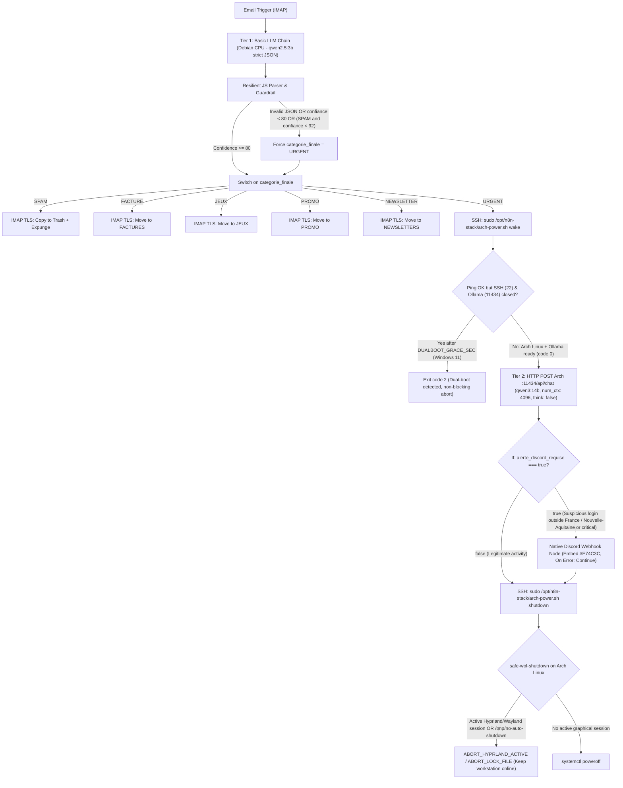
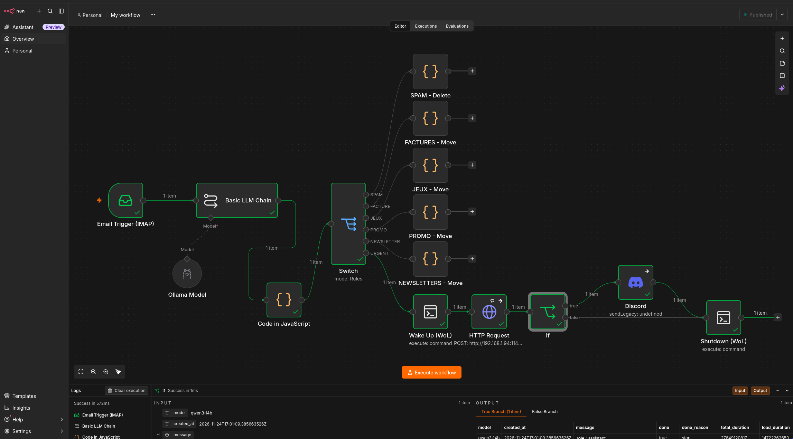
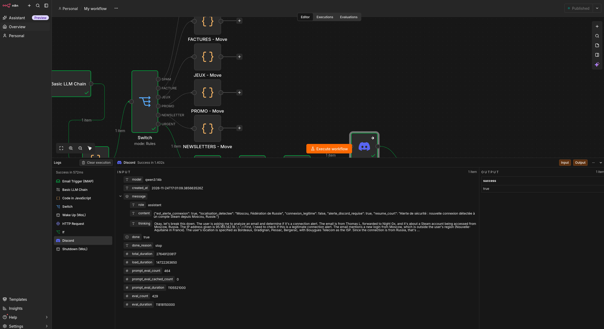
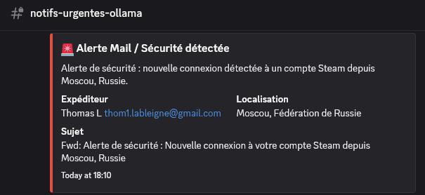
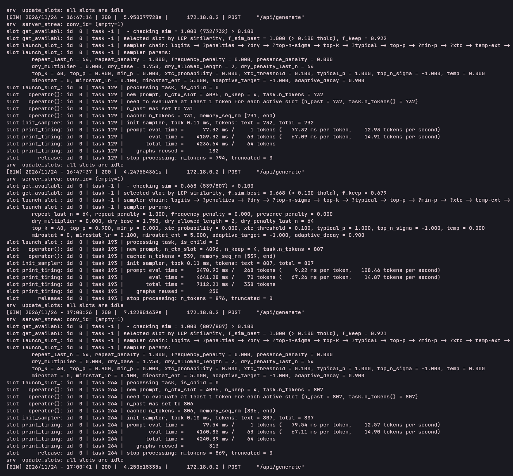

# Local AI Email Triage & Security Automation (n8n + Ollama)

A 100% self-hosted, privacy-first email triage and cybersecurity alerting pipeline combining **n8n**, **Ollama**, **Wake-on-LAN**, and **Discord Webhooks** across a two-tier hybrid homelab architecture.

---

## Overview & Objectives

- **Zero Cloud Leakage:** Every email body, sender address, and inference prompt remains strictly inside the local network. No external LLM APIs are used.
- **On-Demand GPU Power Efficiency:** Routine classification (`SPAM`, `FACTURE`, `PROMO`, `JEUX`, `NEWSLETTER`) runs 24/7 on a low-power Debian server CPU (`qwen2.5:3b`). The GPU workstation stays powered off most of the time and is woken via Wake-on-LAN only for `URGENT` or ambiguous messages.
- **Resilient JSON Guardrails:** A JavaScript post-processor strips Markdown code fences, validates JSON syntax, and forces escalation to the 14B model whenever confidence drops below `80%` (or `< 92%` for `SPAM`).
- **Dual-Boot Safety (Arch Linux / Windows 11):** `scripts/arch-power.sh` detects when Windows 11 is booted instead of Arch Linux and exits cleanly with a dedicated status code (`2`) without blocking the workflow or issuing invalid shutdown commands.

---

## Hybrid Two-Tier Architecture

| Tier | Host / OS | Hardware | Role & AI Workload | Availability |
| :--- | :--- | :--- | :--- | :--- |
| **Tier 1** | Debian 13 (`customerserverdebian`) | AMD Ryzen 5 5500, 16 GB RAM | Docker stack (`n8n` + `ollama-server`), continuous IMAP listener, fast JSON pre-triage with `qwen2.5:3b` (`OLLAMA_NUM_PARALLEL=1`, `OLLAMA_KEEP_ALIVE=24h`), TLS IMAP folder routing | **24/7** |
| **Tier 2** | Arch Linux Workstation (Dual-Boot Windows 11) | AMD RX 6750 XT (12 GB VRAM) | Woken on demand via Wake-on-LAN (`enp9s0`, `Wake-on: g`), contextual & geographic threat analysis with `qwen3:14b` (`num_ctx: 4096`, `"think": false`) | **On demand** |

### Decision Pipeline



---

## Production Walkthrough & Observed Metrics

### n8n Workflow Overview



The workflow orchestrates `Email Trigger (IMAP)`, `Basic LLM Chain` (`qwen2.5:3b`), `Code in JavaScript`, `Switch`, five direct TLS IMAP Code nodes (`SPAM - Delete`, `FACTURES - Move`, `JEUX - Move`, `PROMO - Move`, `NEWSLETTERS - Move`), and the `URGENT` escalation path (`Wake Up (WoL)` -> `HTTP Request` -> `If` -> `Discord` -> `Shutdown (WoL)`).

### Structured JSON Output from `qwen3:14b` (Suspicious Steam Login Example)



In this live execution (`total_duration: 2.76 s` including `1.47 s` model load into VRAM, `464` prompt tokens, `429` generated tokens), `qwen3:14b` flags a login attempt originating outside the expected home region (`Nouvelle-Aquitaine` / `Bouygues Telecom`) and returns deterministic JSON consumed by the `If` and `Discord` nodes:

```json
{
  "est_alerte_connexion": true,
  "localisation_detectee": "Moscou, Fédération de Russie",
  "connexion_legitime": false,
  "alerte_discord_requise": true,
  "resume_court": "Alerte de sécurité : nouvelle connexion détectée à un compte Steam depuis Moscou, Russie."
}
```

### Discord Security Embed (`#E74C3C`)



When `alerte_discord_requise` evaluates to `true`, the native **Discord** Webhook node (`On Error: Continue`) sends a red Embed card (`15158332` / `#E74C3C`) containing the sender, detected geolocation, subject, and short AI summary.

### Tier 1 CPU Inference Logs (`qwen2.5:3b` on Debian 13)



On the headless Debian 13 server (Ryzen 5 5500 CPU), KV-cache slot reuse (`cached n_tokens = 806` on `n_ctx_slot = 4096`) keeps per-email classification between **`4.24 s` and `7.12 s`** at a steady **`~14.9 tokens/s`**.

---

## Edge-Case Hardening & Engineering Decisions

- **Dual-Boot Windows 11 Detection (`scripts/arch-power.sh`):** Because both OSes share the same physical machine and LAN IP, ICMP ping alone cannot distinguish Arch Linux from Windows 11. If the host replies to ping while both SSH (`22`) and Ollama (`11434`) remain closed beyond `DUALBOOT_GRACE_SEC` (`25 s`, preventing false positives during a normal Linux boot), `arch-power.sh` exits immediately with **code `2`**. `arch-power.sh shutdown` enforces the same guard before invoking SSH.
- **LLM Output Resilience & Latency Control:**
  - `Code in JavaScript` strips Markdown code fences before `JSON.parse()` and routes any parse error, unknown category, `confiance < 80`, or `SPAM` with `confiance < 92` directly to `URGENT`.
  - Tier 2 `HTTP Request` sets `"think": false`, `"temperature": 0`, and `"num_ctx": 4096` on `qwen3:14b` to prevent extended reasoning overhead and bound VRAM usage.
  - Tier 1 sets `OLLAMA_NUM_PARALLEL=1` so burst email arrivals queue cleanly without thrashing CPU threads.
- **Workstation Anti-Freeze & Least-Privilege Shutdown:**
  - `systemd/ollama-override.conf` applies `Nice=15`, `CPUSchedulingPolicy=batch`, `IOSchedulingClass=idle`, and `OLLAMA_MAX_LOADED_MODELS=1` on Arch Linux so loading the `9.3 GB` `qwen3:14b` weights never freezes an active **Hyprland/Wayland** desktop session.
  - Instead of granting broad passwordless poweroff rights, Debian only holds a scoped sudoers entry (`<user> ALL=(ALL) NOPASSWD: /usr/local/bin/safe-wol-shutdown`). `scripts/safe-wol-shutdown` aborts cleanly (`exit 0`) if a `Hyprland` process, `/run/user/*/wayland-*` socket, or manual lock file (`/tmp/no-auto-shutdown`) exists.

---

## Repository Structure

```text
n8n-local-mail-triage/
├── .env.example                     # Sanitized environment template with generic placeholders
├── .gitignore                       # Ignores .env, Docker volumes, SSH keys, and logs
├── README.md                        # Architecture documentation & deployment guide
├── docker-compose.yml               # Tier 1 stack (n8n + ollama-server)
├── docs/
│   └── images/
│       ├── 01-n8n-workflow-overview.png
│       ├── 02-n8n-llm-json-output.png
│       ├── 03-discord-security-embed.png
│       └── 04-infrastructure-terminal.png
├── scripts/
│   ├── arch-power.sh                # WoL wake/status/shutdown controller with Dual-Boot detection
│   └── safe-wol-shutdown            # Arch Linux shutdown guard (Hyprland/Wayland & lockfile)
├── systemd/
│   └── ollama-override.conf         # Arch Linux systemd drop-in for CPU/IO/VRAM throttling
└── workflows/
    └── mail-triage-workflow.json    # Sanitized n8n workflow ready for import
```

---

## Deployment Guide

### Prerequisites

- **Tier 1 (Debian 13):** Docker Engine, Docker Compose v2, `openssh-client`, `nc` (`netcat-openbsd`), and `wakeonlan` (or `python3`).
- **Tier 2 (Arch Linux):** Wake-on-LAN capable NIC (`enp9s0`), Ollama with ROCm/GPU acceleration, and OpenSSH server.

### 1. Tier 1 Setup (Debian 13 Server)

Clone the repository and configure environment variables:

```bash
git clone https://github.com/TLableigne/n8n-local-mail-triage.git /opt/n8n-stack
cd /opt/n8n-stack
cp .env.example .env
chmod 600 .env
# Edit .env with your IMAP credentials, Arch MAC/IP, SSH user/key, and Discord webhook
```

Start the stack and pull the Tier 1 model:

```bash
docker compose up -d
docker exec -it ollama-server ollama pull qwen2.5:3b
chmod +x /opt/n8n-stack/scripts/arch-power.sh
ln -sf /opt/n8n-stack/scripts/arch-power.sh /opt/n8n-stack/arch-power.sh
```

### 2. Tier 2 Setup (Arch Linux Workstation)

1. **Enable Wake-on-LAN** in UEFI/BIOS (*Resume by PCI-E Device*) and persist `Wake-on: g` via NetworkManager:
   ```bash
   sudo ethtool enp9s0 | grep Wake-on   # Expected: Wake-on: g
   nmcli connection modify "<Ethernet_Connection_Name>" 802-3-ethernet.wake-on-lan magic
   ```
2. **Install the Ollama systemd drop-in** and pull `qwen3:14b`:
   ```bash
   sudo mkdir -p /etc/systemd/system/ollama.service.d
   sudo cp systemd/ollama-override.conf /etc/systemd/system/ollama.service.d/override.conf
   sudo systemctl daemon-reload
   sudo systemctl enable --now ollama.service
   ollama pull qwen3:14b
   ```
3. **Install the shutdown guard** and scoped sudoers rule:
   ```bash
   sudo install -m 755 -o root -g root scripts/safe-wol-shutdown /usr/local/bin/safe-wol-shutdown
   echo "archuser ALL=(ALL) NOPASSWD: /usr/local/bin/safe-wol-shutdown" | sudo tee /etc/sudoers.d/safe-wol-shutdown
   sudo chmod 440 /etc/sudoers.d/safe-wol-shutdown
   ```

### 3. Import & Configure the n8n Workflow

1. Open n8n (`http://<DEBIAN_IP>:5678`) and import `workflows/mail-triage-workflow.json`.
2. Bind the four credentials in n8n:
   - **IMAP Account** (`Email Trigger (IMAP)`)
   - **Ollama Server** targeting `http://ollama-server:11434` (`Ollama Model`)
   - **SSH Private Key** to run `sudo /opt/n8n-stack/arch-power.sh` on the Debian host (`Wake Up (WoL)` and `Shutdown (WoL)`)
   - **Discord Webhook** (`Discord`)
3. Update the `HTTP Request` node URL (`http://<ARCH_IP>:11434/api/chat`) and ensure your target IMAP folders (`FACTURES`, `JEUX`, `PROMO`, `NEWSLETTERS`) exist.
4. Publish/activate the workflow.

### 4. Manual Power Control & Testing

```bash
# Check workstation status (0 = Ollama ready, 1 = offline, 2 = Windows 11 dual-boot)
./scripts/arch-power.sh status

# Wake Arch Linux and wait for Ollama (exits 2 cleanly if Windows 11 is active)
./scripts/arch-power.sh wake

# Trigger conditional shutdown (aborts cleanly if Hyprland/Wayland is active)
./scripts/arch-power.sh shutdown

# Temporarily block auto-shutdown during maintenance
touch /tmp/no-auto-shutdown
```

---

## Author

Managed by **TLableigne** (`thom1.lableigne@gmail.com`).
